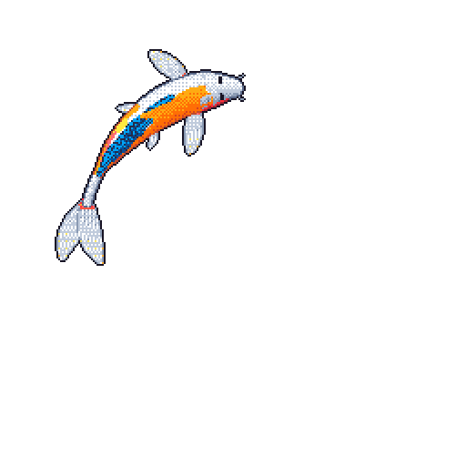

# Ravindu Weerasinghe

  <strong>Software Engineer | AI Graduate</strong> 
  Distributed Systems • Artificial Intelligence • Intelligent Systems

  
  

---

## About Me

- BSc (Hons) in Artificial Intelligence — University of Moratuwa.
- Currently working as a **Software Engineer at Pagero (a Thomson Reuters company)**.
- Interested in designing and building scalable, reliable software systems.
- Particularly interested in distributed systems, software architecture, microservices and cloud-native engineering.
- With an academic background in AI, I'm also passionate about Computer Vision, Machine Perception and intelligent systems.

I enjoy working across the software stack, from understanding system architecture to implementing backend services and exploring how intelligent systems can solve real-world problems.

## Engineering Interests

- Distributed Systems & Microservices
- Software Architecture & System Design
- Backend Engineering
- DevOps & CI/CD
- Cloud Infrastructure
- System Observability & Reliability
- Scalable Software Systems

## Artificial Intelligence

- Computer Vision & Machine Perception
- Robotics & Bionics
- Multimodal Learning
- Explainable AI
- Multi-Agent Systems
- Efficient Deep Learning
- Intelligent & Autonomous Systems

## Featured Projects

- **Sentiview** — An intelligent email monitoring system combining sentiment analysis, automated summarization and sensitive information masking.
- **Autonomous Chess Machine** — A hardware-based chess-playing machine using electromagnets and Hall-effect sensors.
- **StumblePanni** — An AI-powered tourism assistant designed to help travellers explore Sri Lanka.
- **AI Blog Microservice** — A backend microservice built with FastAPI and MongoDB.
- **E-commerce Microservices** — A microservice-based e-commerce application involving user, product, payment and order management.

## AI / ML Stack

  

  Deep Learning • Computer Vision • Representation Learning • Model Optimization 
  Image Processing • Feature Extraction • Multimodal Systems

## Software Engineering

  

  Backend Development • API Design • Microservices • System Design

## Engineering & Infrastructure

  

  Containerization • Cloud Platforms • CI/CD • Deployment Pipelines

## Data & Databases

  

  Data Processing • Database Design • Data Pipelines • System Integration

---

## Git Koi

**Credits:** https://github.com/yalongwastaken/git-koi

---

  <i>Building scalable software and exploring intelligent systems.</i>

